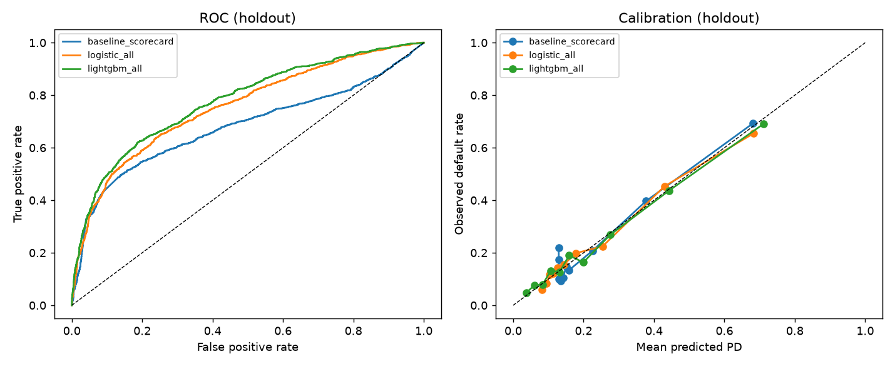

# Credit Default Risk: from Warehouse to Monitored Model

An end-to-end probability-of-default (PD) workflow for a consumer credit product. It covers more than
training a model in a notebook: the data is validated and modelled in a dbt warehouse, the models are
compared in tracked experiments, and only a challenger that is significantly better gets promoted
through a model registry. The promoted model is served behind an API and monitored for drift and
fairness after deployment.



## Pipeline

```
UCI xls ──► ingest + validate ──► DuckDB raw ──► dbt: staging ─► features ─► data tests
                                                                    │
            ┌───────────────────────────────────────────────────────┘
            ▼
   experiments (MLflow) ──► registry + promotion gate ──► FastAPI /score ──► PSI drift + fairness audit
   baseline vs challenger      paired-bootstrap AUC,        same feature SQL
   + feature-group ablations   calibration check            as training
```

| Piece | Where | What it does |
|---|---|---|
| Ingest | `crm/ingest.py` | Downloads the data and runs hard checks that block the load (schema, duplicate ids, nulls, ranges, binary target). It also logs dataset quirks, such as undocumented category codes and negative balances, instead of hiding them. |
| Warehouse | `warehouse/` (dbt + DuckDB) | `stg_credit_clients` renames the columns and cleans the codes. `fct_credit_features` builds 13 behavioural features covering payment history, utilization, repayment ratio and credit line. 14 dbt data tests check the output, including a custom range test. |
| Experiments | `crm/train.py` | Compares a 2-feature logistic scorecard (baseline) with logistic and LightGBM challengers. It also runs an ablation for each feature group, plus an audit run that adds demographics. Every run logs its 5-fold CV AUC and holdout AUC / KS / PR-AUC / Brier / ECE, along with the fitted pipeline, to MLflow. |
| Registry + gate | `crm/registry.py` | A challenger becomes the `champion` alias only if the 95% CI of its paired-bootstrap AUC gain over the champion is above 0 **and** its Brier score does not regress. The decision is written to the model version as a tag. |
| Serving | `crm/serve.py` | `POST /score` takes 6 months of raw account history and returns a PD, a risk band and the model version. Features are computed by running **the same dbt SQL file**, so training and serving cannot drift apart, and a test checks this row by row. |
| Monitoring | `crm/monitor.py` | Computes the PSI of every feature and of the model score against the training population, with OK/WATCH/ALERT thresholds. It runs on a stable batch and on a simulated downturn. A fairness audit reports AUC, mean PD and flag rate by sex and age band. |
| Tests / CI | `tests/`, `.github/workflows/ci.yml` | 20 tests on synthetic data (no network) cover the ingest checks, the real dbt build, hand-computed features, training/serving parity, gate edge cases, PSI and the API. |

## Results (`outputs/results.md`)

| Model | CV AUC | Holdout AUC | KS | Brier |
|---|---|---|---|---|
| Baseline scorecard (2 features) | 0.704 | 0.680 | 0.357 | 0.144 |
| Logistic, all features | 0.770 | 0.756 | 0.399 | 0.140 |
| **LightGBM, all features (champion)** | **0.784** | **0.777** | **0.433** | **0.135** |

What the experiments showed:
- **Payment history carries most of the signal.** Removing it costs 0.063 CV AUC. Removing the
  repayment-ratio group costs only 0.001, so that group could be dropped to make the model simpler.
- **Demographics are not worth using.** Adding sex, education, marriage and age gains just 0.003 AUC, so the shipped
  model leaves them out. They are kept only for the fairness audit, where both sexes get an AUC of 0.78 and
  the flag rate is 12.2% vs 13.0%.
- **The gate does its job.** LightGBM beat the scorecard by +0.097 AUC (95% CI +0.080 to +0.113) and was
  promoted. Re-running the pipeline registers an identical model, and the gate correctly keeps it as a
  candidate.
- **Drift is caught before the score moves.** In the simulated downturn, the repayment-ratio features hit
  PSI ALERT (0.99) while the model score only reaches WATCH (0.13). Watching inputs gives earlier warning
  than watching outputs.

## Run it

```bash
python -m venv .venv && source .venv/bin/activate
pip install -r requirements.txt
python run_pipeline.py          # ~1 min: downloads data, builds warehouse, trains, registers, monitors
pytest -q                       # 20 tests, synthetic data, ~10 s
uvicorn crm.serve:app           # serves the current champion from the registry
mlflow ui --backend-store-uri sqlite:///mlflow.db   # browse runs and model versions
```

```bash
curl -X POST localhost:8000/score -H 'content-type: application/json' -d '{
  "limit_bal": 50000, "pay_status": [2,2,2,1,0,0],
  "bill_amt": [49000,48000,47000,45000,40000,38000], "pay_amt": [0,0,500,1000,1000,1000]}'
# {"probability_of_default":0.6683,"risk_band":"high","model_version":"2"}
```

## Limitations

- The data is a public, 2005, single-snapshot dataset from Taiwan. With no time dimension, the split is
  random rather than out-of-time, so real performance on future cohorts would be lower.
- Everything runs locally (DuckDB, a SQLite-backed MLflow). On a cloud stack the same layout would map to
  Redshift/Snowflake for dbt and a hosted MLflow/S3 artifact store.
- The PSI thresholds (0.10 / 0.25) are industry rules of thumb, not tuned to this portfolio.

Data: Yeh, I. C. (2009). *Default of Credit Card Clients*. UCI Machine Learning Repository (CC BY 4.0).
